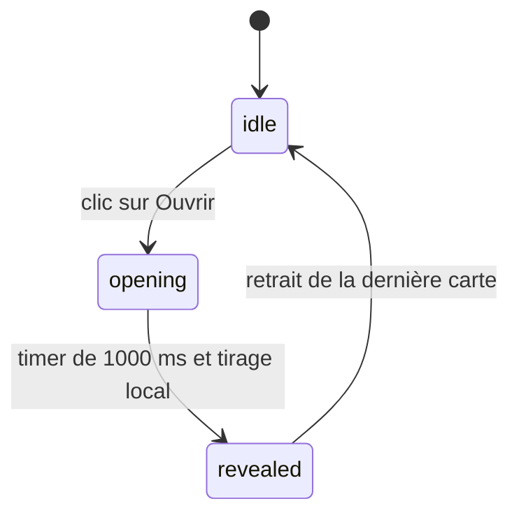

# 6. Boosters et Motion : comprendre toute la séquence

## 6.1 Répartir les responsabilités

| Composant | Responsabilité actuelle |
| --- | --- |
| `HomePage` | État du pack, timer, tirage et remise à zéro |
| `BoosterPack` | Afficher l’illustration seule ; utilisé sur `/play` |
| `BoosterOpening` | Empiler les cartes, autoriser le drag et retirer la carte du dessus |
| `RevealCard` | Retenir si la carte a été retournée et animer sa rotation |
| `CardBack` | Afficher le dos avec le logo |
| `GameCard` | Afficher la face et ses effets |

Sur l’accueil, l’illustration du pack est rendue directement avec ``, et non via `BoosterPack`. Les deux utilisent le même SVG.

## 6.2 Machine à états de l’accueil



Une machine à états énumère les situations possibles et les événements qui les relient. Ici, l’union `BoosterTiming = "idle" | "opening" | "revealed"` rend ces situations explicites.

Le bouton est disponible en `idle`, désactivé pendant la secousse et pendant la révélation, puis réactivé à la fin. Il n’y a pas d’état de bilan du pack.

## 6.3 Les quatre états de `HomePage`

| État | Départ | Utilisation |
| --- | --- | --- |
| `boosterState` | `"idle"` | Choix du pack ou de la pile |
| `buttonState` | `false` | Attribut `disabled` et style du bouton |
| `incrementPacks` | `0` | Clé React de la pile |
| `boosterCards` | `[]` | Cartes issues du tirage local |

`incrementPacks` augmente après le délai, au moment où le tirage est généré. Il n’est pas affiché comme compteur utilisateur. `buttonState` est une information dérivable ; voir le chapitre React.

## 6.4 Ce qui se passe après le clic

1. `handleBoosterState` vérifie `boosterState === "idle"`.
2. Il demande l’état `opening` et bascule le bouton désactivé.
3. Le rendu suivant applique la classe `booster-shake` et une opacité réduite.
4. Le timer programme la suite après 1000 ms au plus tôt.
5. La callback passe à `revealed`, tire cinq entrées et incrémente la clé.
6. React affiche `BoosterOpening` à la place de l’image.

La secousse CSS dure 0,7 seconde par cycle et se répète tant que l’image existe. Elle s’arrête ici grâce au remplacement de l’image, pas parce qu’un écouteur attend la fin de l’animation.

La fonction de tirage ne pondère pas les raretés. Elle choisit parmi les entrées du JSON ; normal et shiny sont déjà deux objets distincts. Il n’existe pas de garantie « une rare au minimum » dans cette implémentation.

## 6.5 Fondamentaux Motion

Le paquet installé s’appelle `motion` et les imports se font depuis `motion/react`.

```tsx
import { motion } from "motion/react";

export function AnimatedExample() {
  return (
    <motion.div
      initial={{ opacity: 0, y: 20 }}
      animate={{ opacity: 1, y: 0 }}
      transition={{ duration: 0.3 }}
    >
      Une animation simple
    </motion.div>
  );
}
```

Exemple pédagogique autonome : `initial` définit l’état de départ, `animate` la cible, et `transition` les modalités de passage. Les durées Motion s’expriment en **secondes**, contrairement aux timers JavaScript exprimés en millisecondes.

`tween` interpole une animation suivant une durée et une courbe. `spring` simule un ressort avec notamment raideur et amortissement. Le projet utilise explicitement `tween` pour le flip, sans lui donner de durée explicite. Voir les [transitions Motion](https://motion.dev/docs/react-transitions).

## 6.6 Le retournement de `RevealCard`

```tsx
const [flip, setFlip] = React.useState(false);

function flipCard() {
  if (flip === false) {
    setFlip(previous => !previous);
    swapFunction();
  }
}
```

La garde empêche un second retournement après mise à jour de l’état. La carte se révèle une fois, puis reste face visible. `swapFunction` est appelée au début du retournement ; le drag n’attend donc pas la fin de l’animation.

```tsx
<motion.div
  className="transform-3d w-75 aspect-2/3"
  animate={{ rotateY: flip ? 180 : 0 }}
  transition={{ type: "tween" }}
>
```

La face avant est déjà tournée de 180° dans son propre élément. Le dos est à 0°. Les deux ont `backface-hidden`.

| Rotation du parent | Dos | Face avant |
| --- | --- | --- |
| 0° | Visible | Orientée à l’envers, cachée |
| Environ 90° | Vue de profil | Vue de profil |
| 180° | Orienté à l’envers, caché | Sa rotation propre + celle du parent rendent la face visible |

Le conteneur extérieur applique une perspective ; le parent des faces conserve la 3D. Sans masquage de la face arrière, tu peux voir une image miroir pendant le retournement.

Le clic est actuellement placé sur un `<div>`. Il fonctionne au pointeur mais ne fournit pas spontanément l’interaction clavier d’un bouton. Une version accessible devrait prévoir activation clavier, nom lisible et indicateur de focus.

## 6.7 La pile et `visibleIndex`

Le code démarre à `visibleIndex = 4`, ce qui suppose cinq cartes indexées de 0 à 4.

```text
Index 4 : au-dessus, première carte présentée
Index 3
Index 2
Index 1
Index 0 : dans le flux, donne la taille de la pile
```

Le `map` ne rend que les cartes dont `index <= visibleIndex`. À ordre DOM et empilement égaux, les dernières cartes superposées se dessinent au-dessus des précédentes.

Quand l’index visible passe de 4 à 3, la carte 4 quitte le rendu et la carte 3 devient le dessus. Une version générique devrait initialiser l’index à `cardsPack.length - 1` et traiter le tableau vide.

## 6.8 Autoriser le drag au bon moment

```ts
function dragIsActive(index: number): false | "x" {
  if (index === visibleIndex && dragOn) return "x";
  return false;
}
```

Il faut satisfaire deux conditions : être la carte du dessus et avoir autorisé le drag. Le flip appelle `changeDragActive`, qui inverse `dragOn`. Le retrait remet `dragOn` à `false`, obligeant à révéler la suivante avant de la glisser.

Un callback `onReveal={() => setDragOn(true)}` exprimerait mieux « autoriser » qu’un simple toggle. Une inversion répétée peut désactiver ce qu’un autre appel voulait activer.

Les cartes sous le dessus existent déjà et ont chacune leur `flip`. Il faut vérifier en pratique que la superposition interdit leur activation accidentelle et que le clavier ne permet pas d’interagir avec des cartes encore masquées si une navigation clavier est ajoutée.

## 6.9 Le drag Motion

```tsx
drag={dragIsActive(index)}
dragMomentum={false}
dragConstraints={{ top: -50, left: -50, right: 50, bottom: 50 }}
onDragEnd={(event, info) => dragEnd(event, info)}
```

`drag="x"` limite le déplacement à l’horizontale. Les contraintes verticales n’ont donc pas de rôle utile tant que cet axe reste le seul autorisé. `dragMomentum={false}` supprime l’inertie après le relâchement ; il ne définit pas une règle métier de validation du swipe.

Motion fournit `PanInfo`. `info.offset.x` mesure le déplacement horizontal du geste et `info.velocity.x` sa vitesse. Le code utilise seulement l’offset. Voir le [guide officiel du drag](https://motion.dev/docs/react-drag).

Ne confonds pas la distance de geste `info.offset.x`, la translation visuelle de l’élément et les limites configurées. Le code combine des contraintes de ±50 avec un seuil de ±100 et l’élasticité par défaut. Il faut mesurer le ressenti au pointeur et au tactile avant de choisir un réglage cohérent ; la lecture des nombres ne valide pas l’interaction réelle.

## 6.10 Relâchement et seuil

```ts
if (info.offset.x < 0) setSwapDirection(true);
else setSwapDirection(false);

if (info.offset.x > 100 || info.offset.x < -100) {
  setVisibleIndex(previous => previous - 1);
  setDragOn(false);
  if (visibleIndex === 0) props.resetFunction();
}
```

Lecture exacte : à gauche, direction `true` ; à droite ou à zéro, `false`. Le retrait n’est validé qu’au-delà de 100 px en valeur absolue. À exactement 100 ou −100, la condition reste fausse.

La direction peut changer même si le geste est trop court. Dans ce cas, le code ne retire pas la carte et ne demande pas explicitement son retour à `x: 0`. Les contraintes et le comportement de relâchement de Motion déterminent le résultat visuel ; un retour métier clair doit être spécifié puis testé.

La vérification `visibleIndex === 0` lit l’index du rendu courant, donc celui de la carte que l’on vient de retirer. Le setter a demandé −1 pour le prochain rendu, mais n’a pas changé cette variable locale.

## 6.11 `AnimatePresence`, `exit`, `variants` et `custom`

```tsx
<AnimatePresence custom={swapDirection}>
  {/* enfants motion ayant une clé et une animation exit */}
</AnimatePresence>
```

Quand une clé disparaît des enfants, `AnimatePresence` peut conserver l’élément le temps de jouer sa sortie. Sans ce mécanisme, l’élément serait simplement démonté avant une animation de sortie. Voir [AnimatePresence](https://motion.dev/docs/react-animate-presence).

Le projet définit une variante dynamique :

```ts
const variants = {
  exit: (direction: boolean) =>
    direction ? { opacity: 0, x: -100 } : { opacity: 0, x: 100 },
};
```

`exit="exit"` sélectionne ce nom de variante. `custom` transmet la direction nécessaire à cette variante, y compris pour un élément en cours de sortie.

Le nombre ±100 désigne une cible de translation. Ce n’est pas automatiquement un déplacement supplémentaire de 100 px depuis le point de relâchement, ni une garantie que toute la carte sort de l’écran.

## 6.12 Le cas particulier de la dernière carte

Au dernier swipe, `resetFunction()` remet immédiatement l’accueil à `idle`. L’accueil cesse alors de rendre `BoosterOpening`, et l’`AnimatePresence` qu’il contient disparaît lui aussi. Sa propre animation de sortie ne peut pas être considérée comme garantie jusqu’au bout.

Une amélioration consiste à attendre la fin de sortie avant le reset, par exemple via une orchestration `onExitComplete` avec une condition explicite de fin du pack. Il faut distinguer « plus de cartes à afficher » et « dernière animation terminée ».

À ce jour : pas de bilan, pas d’ajout en collection, pas de sauvegarde après rechargement.

## 6.13 CSS, Motion ou état React ?

| Besoin | Solution utilisée ici |
| --- | --- |
| Savoir si le pack est prêt ou ouvert | État React |
| Tirer cinq entrées | JavaScript |
| Secouer le pack et déplacer le dégradé | Keyframes CSS |
| Incliner selon le pointeur | DOM + variables CSS |
| Retourner la carte | Cible `rotateY` de Motion |
| Glisser horizontalement | Drag Motion |
| Animer la suppression d’une carte | `AnimatePresence` + `exit` |

Évite de faire contrôler le même `transform` par deux systèmes concurrents sur le même élément. Les wrappers distincts de la pile, du flip et du tilt permettent de séparer les niveaux de transformation.

## 6.14 Pour aller plus loin, sans confondre avec l’existant

`useMotionValue` permet de piloter une valeur visuelle sans nouveau rendu React à chaque mise à jour ; `useSpring` peut lisser son évolution. Ces hooks ne sont pas utilisés dans le code actuel. Ils pourraient servir à une future version du tilt. Voir [Motion values](https://motion.dev/docs/react-motion-value) et [useSpring](https://motion.dev/docs/react-use-spring).

Le hook `useReducedMotion` permettrait aussi d’adapter les animations Motion à la préférence de l’utilisateur. Une interface doit garder une action « carte suivante » utilisable sans imposer un geste de glissement.

## À savoir raconter sans écran

Explique le trajet complet : clic → état opening → secousse → timer → tirage → pile → clic sur le dos → état flip → cible rotateY → drag autorisé → seuil → suppression → sortie → carte suivante → reset. Pour chaque étape, nomme le composant responsable et la donnée modifiée.
